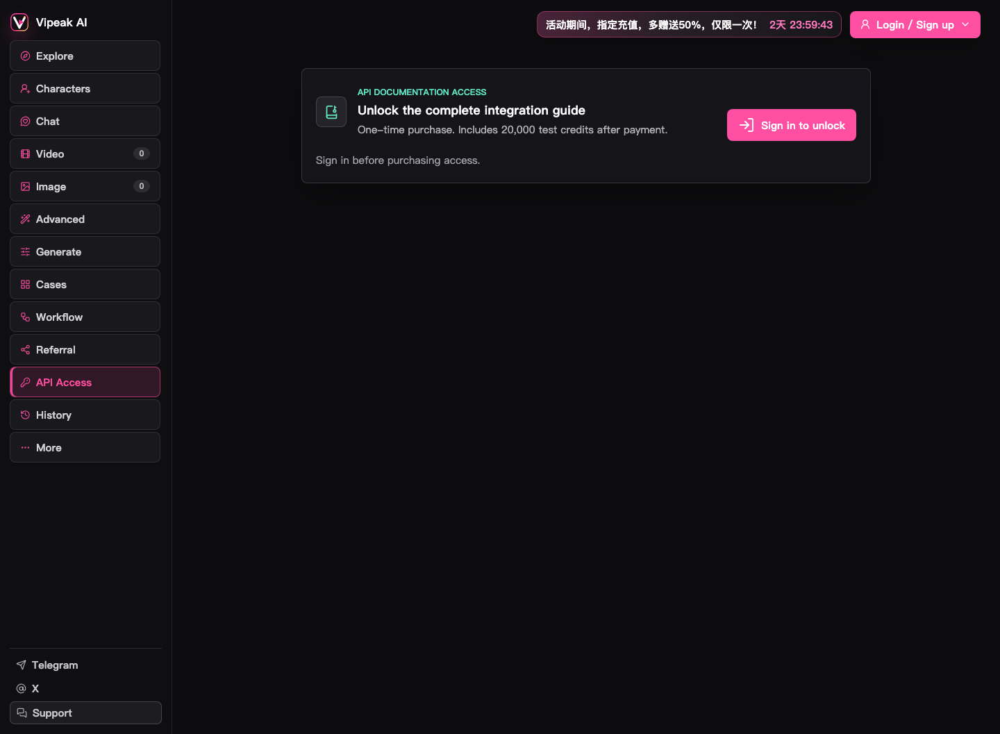

# 123vips.com API 对接说明

主站：<https://123vips.com/>

本文整理从 123vips.com 获取 API 能力、准备接入的流程。完整接口文档需要在登录后获取，因此这里只写公开页面可确认的信息，不猜测未公开参数。

> **费用说明：**在网站内直接生成不需要购买 API 文档权限，生成消耗按站内积分结算。API 对接是单独的开发者能力，购买方式、可用范围和费用以登录后的站内实际页面为准。

## 1. 官方入口

1. 打开 <https://123vips.com/>
2. 完成 18+ 年龄确认
3. 登录或注册账号
4. 点击左侧导航 **API Access**
5. 查看 **API DOCUMENTATION ACCESS**
6. 按站内指引获取完整对接文档
7. 解锁文档与测试积分
8. 按官方文档在服务端接入

直达入口：

<https://123vips.com/#access>

## 2. 当前公开入口与权益

公开页面显示：

```text
API DOCUMENTATION ACCESS
Unlock the complete integration guide
Includes test credits after payment.
Sign in to unlock
```

当前可确认：

| 项目 | 内容 |
|---|---|
| 文档访问方式 | 登录后按站内流程获取 |
| 测试积分 | 开通后包含 test credits，数量以站内实际页面为准 |
| 未登录状态 | 显示 `Sign in to unlock` |
| 站内直接生成 | 不依赖 API 文档权限，按站内积分计费 |

截图（金额已遮挡）：



## 3. 对接前必须确认

由于公开页面没有展示接口细节，正式接入前需要从官方文档确认：

- API Base URL
- 鉴权方式与请求头
- 测试环境和生产环境
- 视频、图片、聊天等能力对应的接口
- 同步/异步任务模型
- 任务查询、Webhook 或轮询方式
- 任务状态与终态判断
- 请求参数、模型名称、分辨率和时长
- 输入文件格式、大小和限制
- 结果 URL 有效期与下载方式
- API 接入费用、积分扣费、失败退款和并发限制
- 限流、超时、重试与幂等要求
- 内容审核和错误码

## 4. 推荐接入架构

```text
用户浏览器 / App
        |
        | HTTPS
        v
业务后端（鉴权、积分、任务、订单、审核）
        |
        +---- PostgreSQL
        |       用户 / 任务 / 积分 / 订单 / 生成记录
        |
        +---- 对象存储
        |       图片 / 视频素材（元数据仍写数据库）
        |
        +---- Vipeak AI API
                地址与鉴权以实际获取的官方文档为准
```

## 5. 服务端职责

### 鉴权与密钥

- API Key 只保存在服务端环境变量或密钥管理服务。
- 不把上游 Key 返回给浏览器。
- 不把 Key、Cookie、支付信息提交到 Git。

### 任务管理

- 创建任务后先写入数据库，状态设为 `queued`。
- 保存上游任务 ID、用户 ID、模型、参数和积分快照。
- 通过轮询或 Webhook 更新任务状态。
- 使用幂等键避免重复扣费和重复生成。
- 对失败任务记录错误码、可重试性和退款结果。

### 数据存储

- 用户、余额、订单、任务、生成记录、素材归属统一写入 PostgreSQL。
- 不使用 JSON 文件、flat-file 或 `data/*.json` 作为正式业务存储。
- 图片/视频文件可以进入对象存储，但必须保留数据库元数据。

### 积分与账单

- 下单前保存价格快照。
- 记录预扣、实际消耗、失败退款和调整记录。
- 后台展示余额、流水、订单和任务消耗。
- 对账时以数据库记录和上游账单双向核对。

## 6. 推荐开发顺序

1. 在服务端配置 API Base URL 和 Key。
2. 实现创建生成任务。
3. 写入 PostgreSQL 任务记录。
4. 实现任务查询或回调接收。
5. 保存结果 URL、积分消耗和完成时间。
6. 前端只展示自己的任务状态。
7. 增加限流、超时、重试、幂等和审计日志。
8. 使用开通后获得的测试积分做小流量验证。
9. 验证内容审核、失败退款和并发限制。
10. 再开放给正式用户。

## 7. 安全与合规

- 主站和角色页面含成人向内容，接入方应实现 18+ 确认。
- 根据目标市场检查内容、支付、广告和分发合规要求。
- 不绕过上游内容审核。
- 对用户上传文件做格式、大小和内容校验。
- 不把任意用户 URL 直接交给服务端下载，避免 SSRF。
- 校验回调签名并防止重放。
- 记录审计日志，但不记录完整密钥和支付凭据。

## 8. 当前核对结论

已核对：

- 主站可访问：<https://123vips.com/>
- API Access 入口存在
- API 文档需要通过登录后的站内 API Access 入口获取
- 未登录时不能解锁文档
- 站内直接生成与 API 文档权限相互独立

未核对：

- 真实 API Base URL
- 鉴权协议
- 接口路径、参数和返回结构
- 回调格式
- API 接入费用、实际调用计费和限额

以上未核对内容必须以后续获取的官方文档为准。
