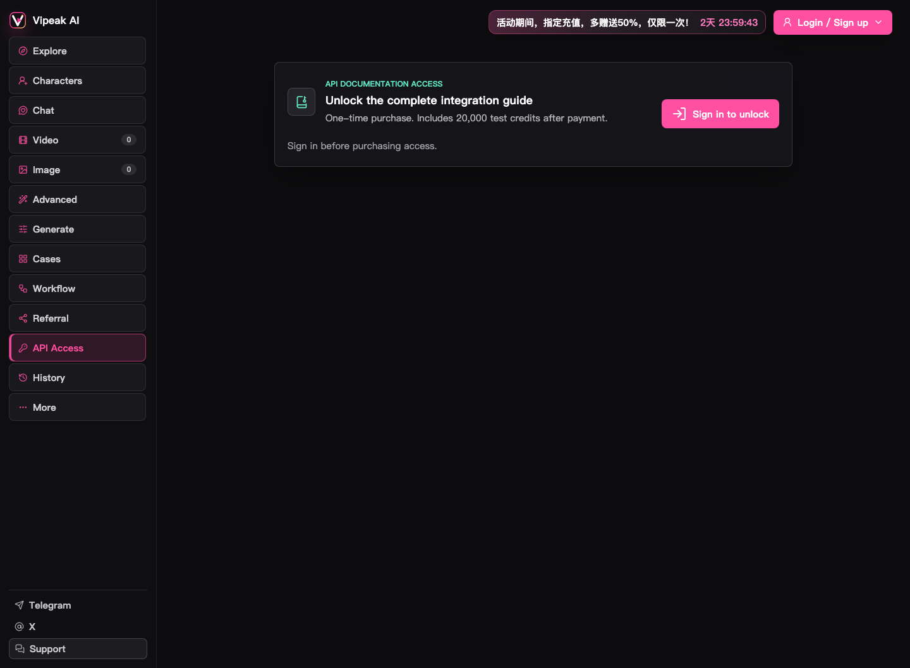
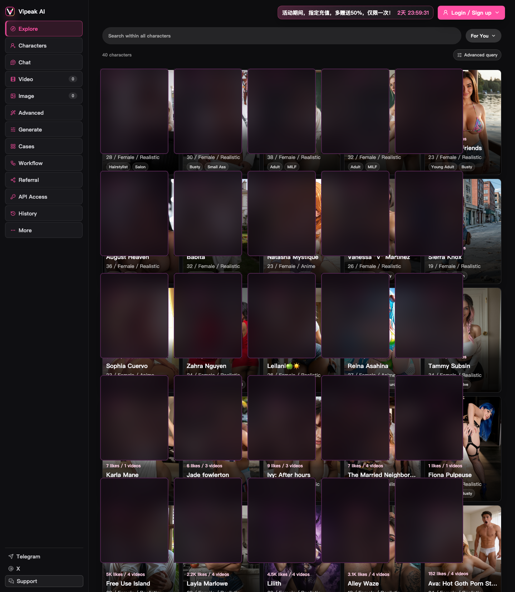
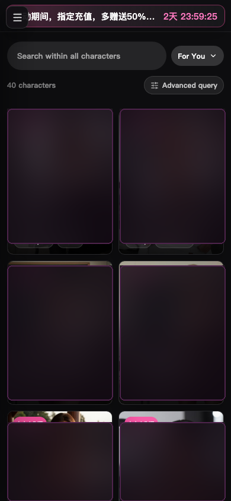

# Vipeak AI 主站介绍与对接说明

> 主站地址：<https://123vips.com/>
>
> 本仓库只做产品介绍、截图和对接资料整理，不包含主站业务代码、用户数据、密钥或部署配置。
>
> GitHub 账号资料见 [GITHUB_ACCOUNT.md](./GITHUB_ACCOUNT.md)。

## 一眼看懂

Vipeak AI 是一个 AI 角色视频与陪伴创作平台。用户可以在主站浏览角色、与角色聊天、用图片或文字生成视频，也可以使用图片生成、案例、工作流和 API Access 等能力。

- 主站：<https://123vips.com/>
- 品牌落地页：<https://123vips.com/site-landing.html>
- 角色与创作工作台：<https://123vips.com/live.html>
- 角色库：<https://123vips.com/characters/>
- 标签：<https://123vips.com/tags/>
- 分类：<https://123vips.com/categories/>
- Telegram 社区：<https://t.me/VipeakAILab>
- Telegram 客服：<https://t.me/VipeakSupportBot>
- X：<https://x.com/VipeakAI>

> 主站面向成年人。进入角色与创作页面时会先显示 18+ 年龄确认。

## 项目定位与关键词

**一句话定位：** Vipeak AI（123vips.com）是面向成年人的 AI 角色视频与陪伴创作平台，提供角色浏览、角色聊天、AI 图片生成、AI 视频生成、图生视频、文生视频、角色模板、案例、工作流和 API 对接入口。

**核心关键词：**

- 产品与场景：`Vipeak AI`、`123vips`、AI 角色、AI 陪伴、AI 角色聊天、角色模板、成人向 AI 角色平台、AI 图片生成、AI 视频生成、图生视频、文生视频、创作工作流
- English keywords: `AI character platform`、`AI companion`、`AI video generator`、`AI image generator`、`image-to-video`、`text-to-video`、`AI character chat`、`character templates`、`creative workflow`
- 开发与对接：`API integration`、API 文档、开发者接入、生成任务、异步任务、Webhook、积分计费、PostgreSQL、对象存储
- 仓库用途：产品介绍、主站截图、API 对接准备、接入架构与安全建议

> 本仓库是产品与对接资料仓库，不是 123vips.com 的网站源代码仓库。面向 AI 搜索与代码助手的结构化摘要见 [llms.txt](./llms.txt)。

## 主站能做什么

### 1. AI 角色浏览与角色库

主站提供角色浏览、标签和分类入口。可以查看推荐角色、角色资料、角色关联的视频和模板，并直接使用角色进入创作流程。

适合：

- 快速找到想使用的角色模板
- 按标签、分类或角色特征浏览内容
- 从角色直接发起图片、视频或聊天任务

### 2. AI 视频生成

主站提供视频创作入口，页面可见的能力包括：

- 图片生视频（Image to Video）
- 文字生视频
- 使用角色模板生成视频
- 查看视频任务与历史记录

视频工作台中的模板弹窗会要求上传参考图、填写 Prompt，然后显示生成成本并提交任务。

### 3. AI 图片生成

主站有独立的 Image 入口，可用于 AI 图片生成。具体模型、尺寸、积分价格和参数以登录后的实际页面为准。

### 4. AI 角色聊天与互动

主站提供 Chat、角色互动、语音/视频陪伴方向的能力。品牌介绍将其描述为“有长记忆的 AI 角色”，强调角色会记住用户提到的事情，关系会随着互动推进。

可体验的方向：

- 文字聊天
- 角色互动
- 视频/语音陪伴（以实际页面开放情况为准）
- 角色关系和记忆连续体验

### 5. 案例、工作流与高级生成

主站还提供：

- **Cases**：查看创作案例与相关提示词、参数
- **Workflow**：工作流和组合式创作能力
- **Advanced**：高级生成与参数入口
- **Generate**：统一的生成入口

适合需要复用案例、批量生产或组合多个生成步骤的场景。

### 6. 账户、积分、充值与历史记录

主站工作台包含：

- 登录/注册
- Video、Image 的当前积分显示
- 充值入口
- 生成历史记录
- Referral 推荐机制
- 客服入口（邮件与 Telegram）

### 7. 站内生成与 API 对接是两回事

**直接在 123vips.com 网站里生成，不需要购买 API 文档权限。** 站内生成按主站账户积分计费，具体消耗以登录后页面显示为准。

API 对接是面向开发者的独立能力。登录主站后，可从左侧 **API Access** 查看 API 文档获取方式；购买方式、可用范围和费用以站内实际页面为准。当前公开页面显示 `Sign in to unlock`，尚未公开 API Base URL、鉴权协议、接口路径或回调格式。

完整对接步骤见 [API_INTEGRATION.md](./API_INTEGRATION.md)。

## 典型使用流程

```text
打开 123vips.com
    ↓
完成 18+ 确认
    ↓
登录 / 注册
    ↓
浏览角色、案例或直接进入生成工作台
    ↓
选择 Video / Image / Chat / Advanced / Workflow
    ↓
上传参考图或填写 Prompt
    ↓
确认积分成本并提交生成
    ↓
在 History 查看任务与结果
```

## 截图

### API Access 页面（金额已遮挡）

截取自 `https://123vips.com/#access`，展示官方 API 文档访问入口和测试积分说明；公开版本不展示具体金额。



### 角色与创作工作台

以下截图来自 `https://123vips.com/`，为公开仓库展示做了安全遮挡。导航、功能入口和页面布局保持可辨认。

**桌面端**



**移动端**



## 站点页面清单

| 页面 | 地址 |
|---|---|
| 首页 | <https://123vips.com/> |
| 品牌落地页 | <https://123vips.com/site-landing.html> |
| 角色与创作工作台 | <https://123vips.com/live.html> |
| 角色库 | <https://123vips.com/characters/> |
| 标签 | <https://123vips.com/tags/> |
| 分类 | <https://123vips.com/categories/> |
| 隐私政策 | <https://123vips.com/privacy> |
| 用户协议 | <https://123vips.com/terms> |

## 技术对接建议

如果准备通过 API 接入，建议先用独立服务端做一层业务网关：

```text
浏览器 / App
    |
    | HTTPS
    v
你的业务后端  --->  PostgreSQL（用户、任务、积分、订单、生成记录）
    |
    | Vipeak AI API（具体地址以官方文档为准）
    v
Vipeak AI
```

关键原则：

- API Key 只放在服务端，不进入浏览器代码。
- 业务数据、积分、订单和生成记录写入 PostgreSQL。
- 图片和视频可以存对象存储，但素材元数据和归属必须写数据库。
- 生成任务采用异步模型，处理排队、轮询/回调、超时和失败重试。
- 上线前完成年龄限制、内容合规、支付和地区可用性评估。

## 适合谁

- 想体验 AI 角色视频与陪伴的用户
- 需要角色模板、图片/视频生成能力的内容创作者
- 准备把 AI 角色生成能力接入自有产品的开发者
- 需要工作流、批量生成或统一积分管理的团队

## 说明

- 本仓库是独立公开介绍仓库，不包含主站源代码。
- 本仓库不保存 Token、API Key、数据库连接、用户数据或支付凭据。
- 成人向内容的可用范围、支付方式和地区限制以主站实际页面及当地法规为准。
- 站内生成、API 接入、模型、接口参数和计费规则以登录后的官方页面及实际开通页面为准。
